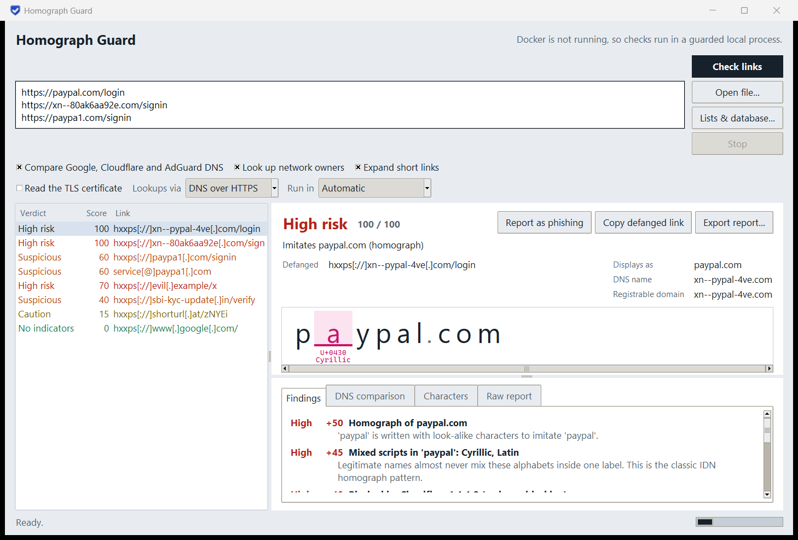

# Homograph Guard

Catch IDN homograph phishing: links and email addresses that swap Latin letters
for identical-looking Cyrillic, Greek, Armenian, Cherokee and other characters.
Homograph Guard shows exactly which characters are impostors, checks links
against a threat database kept **on your device**, and can ask Google,
Cloudflare and AdGuard DNS where a name really leads, comparing it with the
brand it imitates from ten regions of the world. **The suspect link is never opened.**

It comes as a command-line tool, a desktop app that also scans saved emails,
web pages and chat exports, a Windows installer, and a [browser extension](#browser-extension)
for Chrome, Edge, Brave and Firefox that checks the links in the email, chat or
page you are reading. Windows, macOS and Linux are supported.

**Get it:** [Windows installer](https://github.com/Ameya343/homograph-guard/releases/latest) ·
`pip install "git+https://github.com/Ameya343/homograph-guard.git"` · [all download options](#download)



## What it catches

| Trick | Example | How it shows up |
| --- | --- | --- |
| Mixed-script look-alike | `pаypal.com` (Cyrillic а) | `HG_MIXED_SCRIPT`, `BRAND_HOMOGRAPH` |
| Whole-script look-alike | `аррӏе.com` = `xn--80ak6aa92e.com` | `HG_WHOLE_SCRIPT`, `BRAND_HOMOGRAPH` |
| Rare Latin letters, accents | `ɡoogle.com`, `faceboök.com` | `HG_LATIN_LOOKALIKE`, `BRAND_LOOKALIKE` |
| ASCII look-alikes, typos | `paypa1.com`, `rnicrosoft.com`, `paypall.com` | `BRAND_LOOKALIKE`, `BRAND_TYPOSQUAT` |
| Brand decoys | `paypal.com.account-verify.info`, `sbi-kyc-update.in` | `BRAND_SUBDOMAIN_SPOOF`, `BRAND_EMBEDDED`, `URL_LURE_WORDS` |
| Fake host before `@` | `https://www.paypal.com@evil.example` | `URL_USERINFO_DECEPTION`, `URL_USERINFO_BRAND` |
| Hidden characters | zero-width space, soft hyphen, RLO, `∕` and `·` look-alike separators | `URL_INVISIBLE`, `URL_BIDI`, `IDN_FAKE_SLASH`, `IDN_FAKE_DOT` |
| Parser confusion | `evil.com\@google.com`, `%67oogle.com`, `ｇｏｏｇｌｅ．com` | `URL_PARSER_CONFUSION`, `URL_PERCENT_HOST`, `IDN_NORMALIZED` |
| Obfuscated IPs | `http://0x7f.1`, `http://3232235777` | `URL_OBFUSCATED_IP`, `URL_INTERNAL_IP` |
| One-click vectors | `javascript:`, `data:`, `ms-msdt:`, `search-ms:`, `file://attacker/share` | `URL_DANGEROUS_SCHEME`, `URL_APP_HANDLER`, `URL_REMOTE_FILE` |
| Spoofed senders | `PayPal <service@paypa1.com>`, `service@paypal.com <x@mail-paypal.net>` | `EMAIL_DISPLAY_NAME_BRAND`, `EMAIL_DISPLAY_NAME_DOMAIN` |
| Fake link text | text shows `https://www.paypal.com/signin`, link goes to `paypa1.com` | `LINK_TEXT_MISMATCH` |
| Hidden links | `display:none`, zero size, off-screen, `font-size:0`, HTML comments, scripts, meta refresh | `LINK_HIDDEN` |
| Rewritten links | FortiMail, Microsoft Safe Links, Proofpoint, Mimecast, Barracuda, Cisco, Trend Micro, Sophos, Check Point, Symantec, Amazon SES, Google/Facebook/Slack/LinkedIn/Steam redirects | `WRAP_*`, then the real destination is checked |
| Open redirects | `https://news.example/out?url=https://paypal-login.top` | `URL_EMBEDDED_URL` |
| Pop-under ad redirects | ExoClick (`s.pemsrv.com/v1/link.php?...`), PopAds, PopCash: the ad server picks the destination when clicked | `AD_REDIRECT` |
| Short links | `https://shorturl.at/zNYEi`, `bit.ly/...`, `tinyurl.com/...`: where it leads is found out without opening it, then that destination is checked | `URL_SHORTENER_EXPANDED` (then the destination's own findings), or `URL_SHORTENER` (Caution) when it cannot be found out |
| Known phishing and malware | about 264,000 domains and links from public threat feeds, updated daily on your device | `FEED_LISTED` |
| Your own decisions | domains or links you blocked, allowed or reported as phishing | `LIST_BLOCKED`, `LIST_ALLOWED`, `LIST_REPORTED` |

It also understands defanged input (`hxxps://evil[.]com`) and always prints links defanged.

### Links rewritten by security products

Mail gateways and bulk senders rewrite every link so that the click goes
through them first. The host you see is then the wrapper, not the site you end
up on, so Homograph Guard decodes the real destination and checks that:

| Service | Link format | What is decoded |
| --- | --- | --- |
| Fortinet FortiMail | `https://<your FortiMail>/fmlurlsvc/?...&url=...` | `url` (wrapper host is checked too: it cannot be verified) |
| Microsoft Defender Safe Links | `https://*.safelinks.protection.outlook.com/?url=...` | `url` |
| Microsoft Teams Safe Links | `https://statics.teams.cdn.office.net/.../safelinks/...?url=...` | `url` |
| Proofpoint URL Defense v1/v2/v3 | `urldefense.proofpoint.com/v2/url?u=...`, `urldefense.com/v3/__...__;...` | full v2 and v3 decoding |
| Mimecast | `protect-*.mimecast.com/s/...?domain=...` | domain only (the rest is hidden) |
| Barracuda | `linkprotect.cudasvc.com/url?a=...` | `a` |
| Cisco Secure Email | `secure-web.cisco.com/<token>/<url>` | path |
| Trend Micro | `*.trendmicro.com/wis/clicktime/v1/query?url=...` | `url` |
| Sophos | `*.protection.sophos.com/?u=<base64>` | `u` |
| Check Point Harmony (Avanan) | `url.avanan.click/v2/___<url>___.<token>` | path |
| Symantec ClickTime | `clicktime.symantec.com/...?u=...` | `u` |
| Amazon SES click tracking | `*.awstrack.me/L0/<url>/...` | path |
| Google, YouTube, Facebook, Instagram, Slack, LinkedIn, Steam | `google.com/url?q=`, `l.facebook.com/l.php?u=`, ... | the target |

Layers are peeled off one by one, so Safe Links around Proofpoint around a
phishing link is decoded completely. A decoded destination is trusted only when
the wrapper host really belongs to the vendor: `safelinks.protection.outlook.com.evil.example`
is not Safe Links. SendGrid and Mailchimp tracking links hide the destination
entirely and are reported as such.

### Short links

A short link (`bit.ly`, `tinyurl.com`, `shorturl.at`, `t.co`, `is.gd`, `rb.gy`,
`cutt.ly`, `lnkd.in` and others) hides where it goes, which is why phishing
messages use them. Homograph Guard finds out where it leads **without opening
the destination**, and then checks that destination like any other link:

```text
$ homograph-guard https://bit.ly/...
  Short link   https://bit.ly/...
  Destination  https://paypa1.com/signin
   HIGH RISK  70/100  Imitates paypal.com (lookalike) - behind a bit.ly short link to paypa1.com
```

- **The app and the command line** ask the shortening service itself when DNS
  checks are on: one HTTPS request per short link, to the service's address from
  the pinned resolvers, with a valid certificate, an honest User-Agent and no
  cookies. Only the redirect in the answer is read; it is never followed.
- **Some services answer only web browsers** (shorturl.at and is.gd show a
  "checking your browser" page to anything else). Nothing is done to get past
  such a check. The link is reported as **Caution**, with the reason, and you can
  find out where it leads in your browser instead: right-click the link and
  choose **Show where this short link leads** (Homograph Guard extension). A
  background tab that may load nothing but the shortening service (and
  Cloudflare's check) asks it; every other request in that tab, the destination
  included, is blocked before it is sent, and the blocked address is the answer.
  The tab then closes and a card on the page shows where the link leads and what
  is wrong with it. If the service wants a person to confirm, the tab is shown to
  you; the destination stays blocked there.
- **Clicking a short link** is safe-guarded too: when it redirects to a page on
  the database, your blocklist or a high-risk look-alike, the extension stops the
  redirect and shows its warning page instead.
- **Links in emails and chats** are not expanded by themselves: the shortening
  service counts a lookup like a click, which the person who made the link can
  see. They stay **Caution** until you ask (right-click, or check the link on its
  own in the app). A mail gateway scanning on delivery can pass
  `--expand-in-messages`.
- The extension never asks shortening services by itself, only when you choose
  **Show where this short link leads**.

Turn it off with `--no-expand` (or untick **Expand short links** in the app), or
with the setting `short_links` (`app`, `browser` or `off`, see
[Configuration](#configuration)).

## How a check works

1. **Read the link the way a browser does.** Attackers rely on parsers that
   disagree, so the tool re-implements the parts of the WHATWG URL Standard that
   decide the real host: the last `@`, backslashes, percent-escapes, hex and
   octal IPs. It also runs Python's own parser and flags any mismatch.
2. **Convert to the name DNS actually sees.** Unicode hosts are normalised with
   UTS #46 and encoded to punycode (`xn--…`). Characters that browsers silently
   rewrite or drop, such as fullwidth letters and soft hyphens, are reported,
   because the text you read is then not the domain you get.
3. **Inspect every character.** Each one gets its Unicode script and its
   look-alike from a confusables table (after Unicode TR39). Mixing Latin with
   Cyrillic in one label, or a label written entirely in Cyrillic that reads as
   Latin under `.com`, is the classic homograph pattern.
4. **Compare with protected brands.** Hostnames are reduced to "skeletons" at
   three strengths (strict TR39, accents removed, ASCII tricks like `rn`→`m`) and
   matched against about 200 global and Indian brands, plus any you add.
5. **Look it up on the device.** The local threat database and your own
   allow, block and report lists are checked. Nothing leaves the computer.
6. **Optionally, ask several resolvers, on pinned addresses.** DNS-over-HTTPS
   queries go straight to fixed IPs for Google, Cloudflare and AdGuard, with the
   TLS certificate verified. Your local network and its DNS cannot answer on
   their behalf.
7. **Compare the answers.** Filtering resolvers (Cloudflare 1.1.1.2, AdGuard
   default) are checked against their unfiltered twins to detect blocks. The
   suspect's addresses are compared with the real brand's, as seen from ten
   regions, by address, subnet, announced network prefix and network owner (ASN).
8. **Score with reasons.** Every finding carries a weight that you can read.
   Findings such as "shares the brand's own nameservers" subtract points, so
   defensive registrations owned by the brand are not over-flagged.

## Privacy

| What | Leaves your device? |
| --- | --- |
| The threat database, your allow/block lists, reported links, settings | No. They live in your data folder (owner-only on macOS and Linux). |
| Links the extension checks, with the default privacy setting (**Device only**) | No. The app on your device answers; without the app, the extension checks in the browser. |
| The daily database update | Only plain downloads of the public lists (`GET`, no query string, no cookies, no identifiers). |
| DNS checks (extension setting **Suspicious links** or **Every link**, or the CLI and GUI unless `--no-dns`) | The **host name** goes to Google, Cloudflare and AdGuard DNS. Never the path, the page or the email. |
| Short links (the app with DNS checks on, or when you choose **Show where this short link leads**) | The short link goes to its own shortening service (bit.ly, shorturl.at, ...), as a click would. The destination is never contacted. Not done by itself for links in emails and chats. |

When DNS checks are on:

- Every query carries an empty EDNS Client Subnet (`0.0.0.0/0`), so the
  resolver does not pass your network on to the site's DNS server.
- Regional comparisons use fixed cloud-provider prefixes, never yours.
- For links in **emails and chats** only the registered domain is looked up
  (`example.com`, not `a8f3k2.track.example.com`). A sub-domain made for one
  recipient would otherwise act as a read receipt.

There is no telemetry, no account and no server of ours. An enterprise lab with
a TLS-inspecting proxy recorded every request the app made; see
[ENTERPRISE.md](ENTERPRISE.md#what-crosses-the-network).

## Install

### Download

| What | Where to get it | For |
| --- | --- | --- |
| Windows installer | [Releases](https://github.com/Ameya343/homograph-guard/releases/latest): `HomographGuard-Setup-1.3.0.exe` and `HomographGuard-Setup-1.3.0.exe.sha256` | 64-bit Windows 10 or 11; no Python needed |
| Python package | `pip install "git+https://github.com/Ameya343/homograph-guard.git"` (needs Git), or without Git `pip install https://github.com/Ameya343/homograph-guard/archive/refs/heads/main.zip`, or the `.whl` file from [Releases](https://github.com/Ameya343/homograph-guard/releases/latest) | Windows, macOS and Linux with Python 3.11 or newer |
| Source code, with the browser extension | `git clone https://github.com/Ameya343/homograph-guard.git`, or **Code → Download ZIP** at the top of this page | the extension without the installer, Docker, building it yourself |

Before running the installer, check that it is the file that was published. The two
values must be the same:

```powershell
(Get-FileHash .\HomographGuard-Setup-1.3.0.exe -Algorithm SHA256).Hash.ToLower()
Get-Content .\HomographGuard-Setup-1.3.0.exe.sha256
```

The installer is not code-signed, so the first time Windows SmartScreen may show
*Windows protected your PC*. Choose **More info → Run anyway** only if the values match.
The browser extension comes with the installer (in its folder) and with the source code
(the `extension` folder); see [Browser extension](#browser-extension) to add it to your browser.

### Windows installer

`HomographGuard-Setup-1.3.0.exe` installs for the current user (no administrator
rights) into `%LOCALAPPDATA%\Programs\HomographGuard`, with everything it needs
(no Python required). You can choose:

| Component | What it does |
| --- | --- |
| Homograph Guard (always) | the desktop app, the command-line tool, the browser helper and the updater |
| Shortcuts | Start menu and desktop shortcuts, plus *Add the browser extension* |
| Browser extension helper | connects the extension in Edge, Chrome, Brave and Firefox to the app |
| Daily threat-database updates | a Task Scheduler task (runs as you, with least privilege) and a first download |
| Firewall rules (off by default) | asks for administrator rights once; see [ENTERPRISE.md](ENTERPRISE.md#windows-firewall-rules) |

A power cut, shutdown or forced restart (Windows Update, a firmware update) cannot leave a
half-installed copy: the new version is unpacked next to the old one and swapped in with two
folder renames, so the previous version keeps working until the new one is complete. Every
step can be repeated, so running Setup again finishes an interrupted installation (the app
reminds you if one did not finish), and the daily task completes an interrupted first
download by itself. For that reason Setup only installs into a new or empty folder, or the
one it is already in.

Silent install: `HomographGuard-Setup-1.3.0.exe /S [/FIREWALL] [/NOSHORTCUTS] [/NOEXTENSION] [/NOUPDATES]`.
Silent uninstall: `Uninstall.exe /S [/PURGE]` (`/PURGE` also deletes your lists and the database).
To build it yourself: `powershell -File packaging\windows\build.ps1` (downloads Python
packages by hash and NSIS by pinned SHA-256, then writes `dist\HomographGuard-Setup-1.3.0.exe`).

### macOS and Linux (and Windows without the installer)

Python 3.11 or newer:

```bash
python3 -m venv ~/.homograph-guard && . ~/.homograph-guard/bin/activate   # Windows: .venv\Scripts\activate
pip install "git+https://github.com/Ameya343/homograph-guard.git"   # or a downloaded .whl, or `pip install .` in the source folder
homograph-guard update                       # download the threat database
homograph-guard setup schedule install       # refresh it every day
homograph-guard native-host install          # connect the browser extension to the app
homograph-guard https://xn--80ak6aa92e.com
```

| | Windows | macOS | Linux |
| --- | --- | --- | --- |
| Data folder | `%LOCALAPPDATA%\HomographGuard` | `~/Library/Application Support/HomographGuard` | `$XDG_DATA_HOME/homograph-guard` (`~/.local/share/...`) |
| Daily update (retried hourly for 12 hours and after sign-in) | Task Scheduler task | launchd agent (`~/Library/LaunchAgents`) | systemd user timer, or cron where there is no systemd session |
| Browser helper registration | registry, per user or `--machine` | `NativeMessagingHosts` folders | `NativeMessagingHosts` folders |
| Organisation policy file | `%ProgramData%\HomographGuard\policy.json` | `/Library/Application Support/HomographGuard/policy.json` | `/etc/homograph-guard/policy.json` |

All of these run as the signed-in user. `native-host install --machine` (root
or administrator) registers the helper for every user. Snap and Flatpak
browsers may not be allowed to start programs outside their sandbox; the
extension then checks in the browser instead.

### Docker sandbox

```bash
docker build -t homograph-guard .
sandbox/run.sh https://xn--80ak6aa92e.com           # Linux / macOS
.\sandbox\run.ps1 https://xn--80ak6aa92e.com        # Windows PowerShell
sudo sandbox/egress-firewall.sh up                  # optional, Linux: resolver-only egress
```

### Desktop GUI

```bash
homograph-guard-gui            # or: python -m homograph_guard.gui
```

The GUI is a viewer only. Each batch runs in the Docker sandbox when the image
is built, and otherwise in a separate guarded `python -I` process. The window
draws the hostname with impostor characters highlighted and labelled with
their code point and script. On Debian, Ubuntu or Kali, install Tk first with
`sudo apt install python3-tk`.

**Open file…** also takes a saved email (`.eml`), a saved web page (`.html`) or
an exported chat (`.txt`). The isolated worker, not the window, reads the file
and checks every link in it: sender addresses, visible links, hidden links,
addresses written as plain text, and links whose text names a different site.
**Lists & database…** shows the database and its feeds, the DNS privacy
setting, and your allow, block and reported lists (with import and export).
**Report as phishing** adds the checked link to your reported list.

### Browser extension

The `extension/` folder works in Chrome, Edge, Brave and Chromium (121 or newer)
and in Firefox (128 or newer).

- **Chrome, Edge, Brave:** open `chrome://extensions` (or `edge://extensions`),
  turn on **Developer mode**, choose **Load unpacked** and select the
  `extension` folder. The installer puts a copy in its folder and opens a
  setup page that shows the path.
- **Firefox:** open `about:debugging`, *This Firefox*, **Load Temporary Add-on**,
  and pick `extension/manifest.json`. Release Firefox keeps unsigned add-ons
  only until it restarts; for permanent use, sign it on addons.mozilla.org
  (unlisted) or deploy it by policy (see [ENTERPRISE.md](ENTERPRISE.md#browser-extension)).

The popup has one switch: protection on or off. While it is on, the extension
checks only what you are looking at:

| Where | What is checked |
| --- | --- |
| Gmail, Outlook, Yahoo Mail | the open email (its links and its sender), not the inbox |
| Discord, WhatsApp, Telegram, Slack, Teams, Messenger | the open conversation, messages from about the last 24 hours |
| Any other site | the current page |

Each link goes through the same checks as the app (look-alike characters, brand
imitation, parser tricks, rewritten links, fake link text, hidden links,
addresses written as text) and, when the app is installed, the threat database
and your lists on this device. Risky links are outlined in red or orange,
a panel lists them with the reasons, hovering shows the real destination, and
clicking one opens a warning instead of the site. Opening a link that is on the
database or your blocklist directly (typed, or from another program) shows a
full-page warning, and so does a link that redirects there (a short link, a
tracker). Right-click a link to report it, trust its site or block it, and on a
short link choose **Show where this short link leads** (see [Short links](#short-links)).
**Options** (from the popup) shows whether the app is connected, the DNS
privacy setting, and your lists.

It never touches what you write: links in a reply, a draft or any other editable
area are not checked, marked or intercepted, so nothing is added to a message you
send. A page with only safe links is not modified at all, and clicks on anything
but a flagged link reach the site as usual. On very long pages the 400 links
nearest to what you are reading are checked, and more as you scroll.

On ordinary websites, a site's own `javascript:` buttons and hidden menu links
are normal, so they are not counted against it; in emails and chats they are.
Names under company-owned top-level domains such as `.microsoft` or `.google`
are never treated as impersonation, because only that company can register them.

To try it in the Chrome or Edge installed on your computer without touching your
own profile:

```bash
cd browser-test && npm install
node run.mjs --browser edge            # or chrome
node run.mjs --browser edge --sites    # also visit a few real websites and list anything flagged
```

## Threat database and your lists

The database holds public phishing and malware lists, refreshed once a day. A
list that suddenly shrinks below a fifth of its last size is treated as broken
and the previous copy is kept.

Interrupted downloads finish on their own. Each list is saved in one database
transaction, so a power cut, shutdown, forced restart or lost connection leaves
every list either fully old or fully new. Whatever is missing downloads again:
a dropped connection is retried a few seconds later, a failed list after 15
minutes, then 30, 60 and so on, the daily task runs every hour for the 12 hours
after its start time and 10 minutes after you sign in, and each run fetches
only what is due. If the database file is ever damaged (a failing disk, a write
cut off by the hardware), the next update sets it aside and builds a new one
with your lists, which are also kept in `lists-backup.json` next to it.

| Feed | Contents | Licence |
| --- | --- | --- |
| `openphish` | OpenPhish community feed (links) | OpenPhish community licence (non-commercial) |
| `phishing-filter` | OpenPhish, PhishTank and IPThreat domains | CC0 / source licences |
| `urlhaus-filter` | URLhaus malware hosts (abuse.ch) | CC0 |
| `cert-pl` | CERT Polska warning list | CERT Polska open data |
| `phishing-army` | Phishing Army blocklist | CC BY-NC 4.0 |
| `hagezi-tif` | HaGeZi Threat Intelligence Feeds (mini) | GPL-3.0 |
| `adguard-dns` (off) | AdGuard DNS filter: ads and trackers | GPL-3.0 |

Check the licences before commercial use; any feed can be turned off
(`settings set feeds '{"openphish": false}'`, or by policy).

```bash
homograph-guard update [--force] [--feed NAME] [--proxy URL] [--cafile FILE]
homograph-guard db status
homograph-guard block add evil.example --note "seen in a phishing test"   # a domain covers its sub-domains
homograph-guard block add https://shared-host.example/phish/login         # a link covers longer links
homograph-guard allow add partner-portal.example                          # never flag this site
homograph-guard report add https://paypa1.com/signin                      # treat as phishing from now on
homograph-guard allow list | block list | report list
homograph-guard lists export my-lists.json | lists import my-lists.json
homograph-guard settings show | settings set dns_mode suspicious
homograph-guard setup schedule install | status | uninstall
homograph-guard native-host install | status | uninstall [--browser chrome firefox] [--machine]
```

Public suffixes (`co.uk`), shared platforms (`github.io`), company-owned TLDs and
the protected brands themselves cannot be blocked as a whole domain; block the
exact link instead.

## Command line

```bash
homograph-guard "https://pаypal.com/login"                  # one link
homograph-guard -f urls.txt                                 # a file, one per line
homograph-guard "PayPal Support <service@paypa1.com>"       # email sender
homograph-guard --no-dns "аррӏе.com"                        # fully offline
homograph-guard --eml suspicious.eml                        # every link in an email, hidden ones too
homograph-guard --html saved-page.html                      # a saved web page
homograph-guard --text whatsapp-chat.txt                    # every address in an exported chat
sandbox/run.sh --eml - < suspicious.eml                     # the same, inside the Docker sandbox
homograph-guard --jsonl -f urls.txt > results.jsonl         # for a SIEM
homograph-guard --brand mycompany.in --brands domains.txt URL   # protect your own domains
homograph-guard --transport dot URL                         # DNS over TLS (or udp)
homograph-guard --tls-peek URL                              # read the site's certificate
homograph-guard --no-db URL                                 # ignore the database and your lists
homograph-guard --list-resolvers
```

Sample output (offline, trimmed):

```text
  Input        https://pаypal.com/login
  Defanged     hxxps[://]xn--pypal-4ve[.]com/login
  Displays as  pаypal.com
  DNS name     xn--pypal-4ve.com

   HIGH RISK   100/100  Imitates paypal.com (homograph)

  Findings
  HIGH      +50  Homograph of paypal.com
  HIGH      +45  Mixed scripts in 'pаypal': Cyrillic, Latin
  MEDIUM    +20  Brand name combined with credential-lure words

  Characters of label 'pаypal'  (scripts: Cyrillic, Latin; minimally-restrictive)
    #  chr  code     script      looks like  name
    2  а    U+0430   Cyrillic    a           CYRILLIC SMALL LETTER A
```

Exit codes: `0` no or minor indicators, `3` suspicious, `4` high risk, `1`
error, `2` usage error. Use them in shell scripts and SOAR playbooks.

## Reading the DNS comparison

Real output from the test suite's local DNS lab (fake resolvers, invented addresses):

```text
  DNS comparison  (transport: UDP, pinned resolver IPs)
  google (lab)                                  NOERROR   185.10.10.10      AS48282 HOSTING-RU, RU
  cloudflare (lab)                              NOERROR   185.10.10.10      AS48282 HOSTING-RU, RU
  cloudflare-security (lab)              filter BLOCKED   0.0.0.0
    -> answered 0.0.0.0 (null route)
  adguard-unfiltered (lab)                      NOERROR   185.10.10.10      AS48282 HOSTING-RU, RU
  adguard (lab)                          filter BLOCKED   0.0.0.0
    -> EDE 15 Blocked
  consensus: identical
  nameservers: ns1.evilhost.example
  compared with real paypal.com from 10 regions: different-network  (1 address, 1 network)
    real site by region: 64.4.250.36 (all 10 regions)
    look-alike by region: 185.10.10.10 (all 10 regions)
```

| Signal | What it means |
| --- | --- |
| Blocked by Cloudflare 1.1.1.2 or Quad9 | A security-only filter flagged the domain. Strong evidence. |
| Blocked by AdGuard default | AdGuard blocks phishing, and also ad and tracker domains. A strong hint, not proof. |
| Different IPs, same network | Normal for CDNs and GeoDNS. |
| Resolvers disagree on network | Possible DNS manipulation, fast-flux or geo-steering. Investigate. |
| Same IP or nameservers as the real brand | Probably a defensive registration owned by the brand. Lowers the score. |
| Same hosting provider only (Cloudflare, AWS, …) | Proves nothing: anyone can host there. |
| Different network from the real brand | Consistent with impersonation. Raises the score. |
| NXDOMAIN | Not registered or already taken down. It may be activated later, so it is not "safe". |
| Resolver TLS intercepted | A proxy or antivirus is re-signing TLS, so answers may be altered. |

**The real brand from ten regions.** Large brands answer with different
addresses in different parts of the world. The brand (and the suspect) are
therefore also looked up as if from the US East and West, Brazil, the UK,
Germany, India, Singapore, Japan, Australia and South Africa (Google DNS with a
fixed EDNS Client Subnet per region; Cloudflare ignores that option). The
suspect's addresses are then compared with every address the brand uses:

| Relation | Means | Score |
| --- | --- | --- |
| `same-ip` | an address the brand itself uses | −20 |
| `same-subnet` | the same /24 (IPv4) or /48 (IPv6) as one of the brand's addresses | −15 |
| `same-prefix` | inside a network prefix the brand's network announces (BGP) | −12 |
| `same-network` | the brand's own network (ASN), not a public hosting provider | −10 |
| `shared-provider` | the same cloud or CDN (Cloudflare, AWS, Google Cloud, Akamai, …): proves nothing | 0 |
| `different-network` | none of the above | +20 |

Network owners and prefixes come from Team Cymru's IP-to-ASN service, which is
queried over DNS through the same pinned resolvers.

| Key | Addresses | TLS name | Filters |
| --- | --- | --- | --- |
| `google` | 8.8.8.8, 8.8.4.4 | dns.google | no |
| `cloudflare` | 1.1.1.1, 1.0.0.1 | cloudflare-dns.com | no |
| `cloudflare-security` | 1.1.1.2, 1.0.0.2 | security.cloudflare-dns.com | malware, phishing |
| `adguard-unfiltered` | 94.140.14.140, 94.140.14.141 | unfiltered.adguard-dns.com | no |
| `adguard` | 94.140.14.14, 94.140.15.15 | dns.adguard-dns.com | ads, trackers, phishing |
| `adguard-family`, `quad9`, `quad9-unfiltered` | | | optional |

## Configuration

- **Your own brands.** The built-in list covers major global services and
  Indian banks, payments and government portals (SBI, HDFC, ICICI, Paytm, UIDAI,
  IRCTC and others). Add yours with `--brand`, or with `--brands FILE` (one
  domain per line). Use `--only-my-brands` to drop the built-in list.
- **Full Unicode confusables table.** The tool ships a curated table of about
  200 characters. For the complete table, download `confusables.txt` from
  unicode.org/Public/security/latest/ and pass it with `--confusables FILE`.
- **Settings** (`homograph-guard settings show`): `dns_mode` (`off`,
  `suspicious`, `all`) for the extension; `short_links`: `app` (default: the app
  asks shortening services, and your browser asks those that answer only
  browsers), `browser` (only your browser asks, when you choose **Show where this
  short link leads**: for networks where only the browser may reach the internet)
  or `off` (nobody asks); `feeds`, `proxy` and `cafile` for the updater.
- **Corporate proxy and TLS inspection.** `settings set proxy http://proxy:8080`
  and `settings set cafile corp-root.pem`; for one run, `update --proxy ... --cafile ...`.
- **Organisations** can lock any setting and add company-wide allow and block
  lists with a policy file. See [ENTERPRISE.md](ENTERPRISE.md).

## Development

```bash
pip install -e ".[dev]"
make test            # about 300 tests, including a local multi-resolver DNS lab
make lint            # ruff + bandit
make check-install   # build a wheel, install it in a fresh venv, run the installed commands
make extension-test  # the extension's JavaScript tests (Node 22+)
make extension-e2e   # the extension in Chromium, alone and through the app (pip install playwright; playwright install chromium)
make extension-compat LIVE=--live   # sites keep working: drafts untouched, site handlers, strict CSP, 5,000 links, real sign-in pages
make extension-browser BROWSER=edge   # the extension in your installed Chrome or Edge (needs Node)
make extension-data  # regenerate extension/lib/data.js after changing brands, confusables, ...
```

The extension re-implements the analysis in JavaScript, but all of its data
(confusables, brand skeletons, public suffixes, lure words, resolvers, regions)
is generated from the Python package, and `tests/vectors/` holds the cases both
implementations must agree on exactly.

The tests start fake Google, Cloudflare and AdGuard resolvers on loopback
addresses. They answer over UDP, TCP, DNS-over-TLS and DNS-over-HTTPS, using a
throwaway CA, and can answer differently per client subnet (GeoDNS). Blocking,
CDN behaviour, regional answers, defensive registrations and disagreeing
resolvers are therefore tested without any internet access. The lab uses fixed
loopback ports, so run one test session at a time. Other tests run
the updater against a local HTTPS feed server, fuzz the browser helper's
message protocol, and simulate macOS and Linux paths, browser registrations and
schedules on any OS.

Tested on Windows 11 (Edge, Chrome and Firefox; the installer; the firewall
rules) and on Debian 13 in a container (the full test suite, the extension in
Chromium with and without the app, the systemd timer, and an enterprise network
with a TLS-inspecting proxy). macOS is covered by those simulated tests and by
the macOS jobs in the CI workflow, but it has not been run on a Mac yet.

```text
src/homograph_guard/
  urlsafe.py        browser-faithful URL / email parsing
  unicode_tools.py  scripts, confusable skeletons
  homograph.py      per-label character analysis
  brands.py         protected-brand matching
  dns_transport.py  DoH / DoT / UDP clients on pinned IPs
  dns_check.py      multi-resolver comparison, brand infrastructure from ten regions
  guard.py          audit-hook sandbox
  analyzer.py       pipeline and scoring inputs
  unwrap.py         security-gateway, redirect and click-tracking link decoding
  expand.py         where a short link leads (asks the shortening service, never the destination)
  extract.py        links in emails, HTML and text (hidden links, fake link text)
  threatdb.py       the on-device database (SQLite) and your lists
  feeds.py          the public threat feeds and the updater
  settings.py       settings and the organisation policy file
  native_host.py    the browser helper (native messaging)
  native_install.py registers the helper with each browser
  schedule.py       the daily update on Windows, macOS and Linux
  winsetup.py       Windows Task Scheduler and firewall rules
  gui/              Tkinter viewer, lists window and isolated worker
extension/          browser extension (Manifest V3, Chrome and Firefox)
  lib/              JavaScript port of the analysis, lists and DNS-over-HTTPS comparison
  content/          finds the links in the open email, chat or page and marks them
  popup/            the on/off switch
  options/          connection status, DNS privacy setting and lists
  warning/          the full-page warning for blocked sites
packaging/windows/  PyInstaller entry points, NSIS installer and build script
sandbox/            hardened docker run scripts and egress firewall
scripts/            install check, extension data and icon generators
browser-test/       runs the extension in your installed Chrome or Edge
```

## Limitations

- DNS and text checks cannot see page content. A clean result means no
  homograph, database or DNS indicators were found. It does not mean the link
  is safe.
- The threat feeds are only as fresh as their last update, and new phishing
  domains appear every minute.
- Brand matching is only as good as the brand list. Add your organisation's
  domains.
- Legitimate internationalised domains in Cyrillic, Greek or other scripts
  may be flagged under `.com`, as Chrome flags them. They stay quiet under
  their own country TLDs.
- Release Firefox needs a signed copy of the extension for permanent use.
- A short link whose service answers only browsers stays a Caution until you
  use **Show where this short link leads**. A shortening service can show a
  different destination later, or to someone else; the check tells you where the
  link led when it was asked.

## License

MIT. See [LICENSE](LICENSE).
